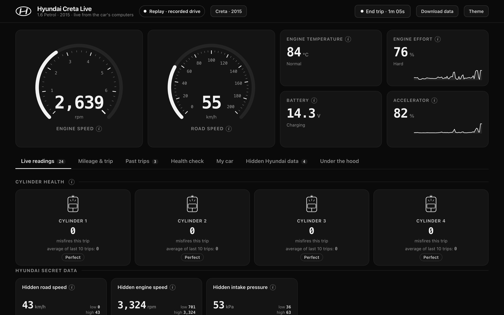
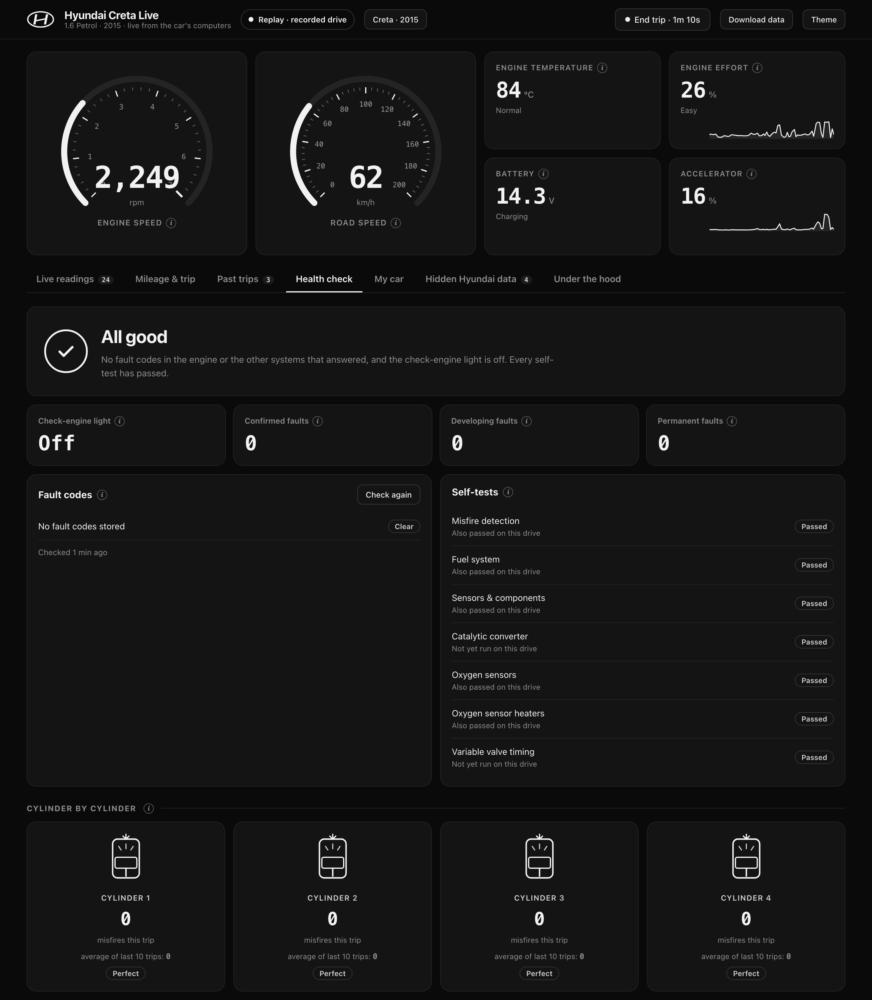
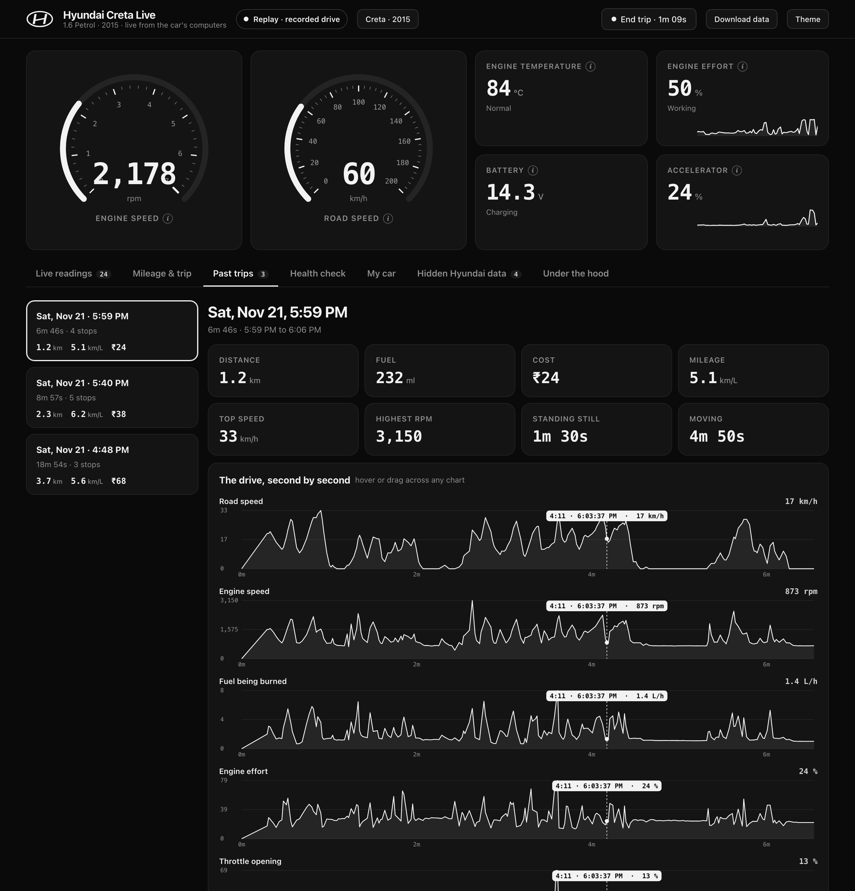
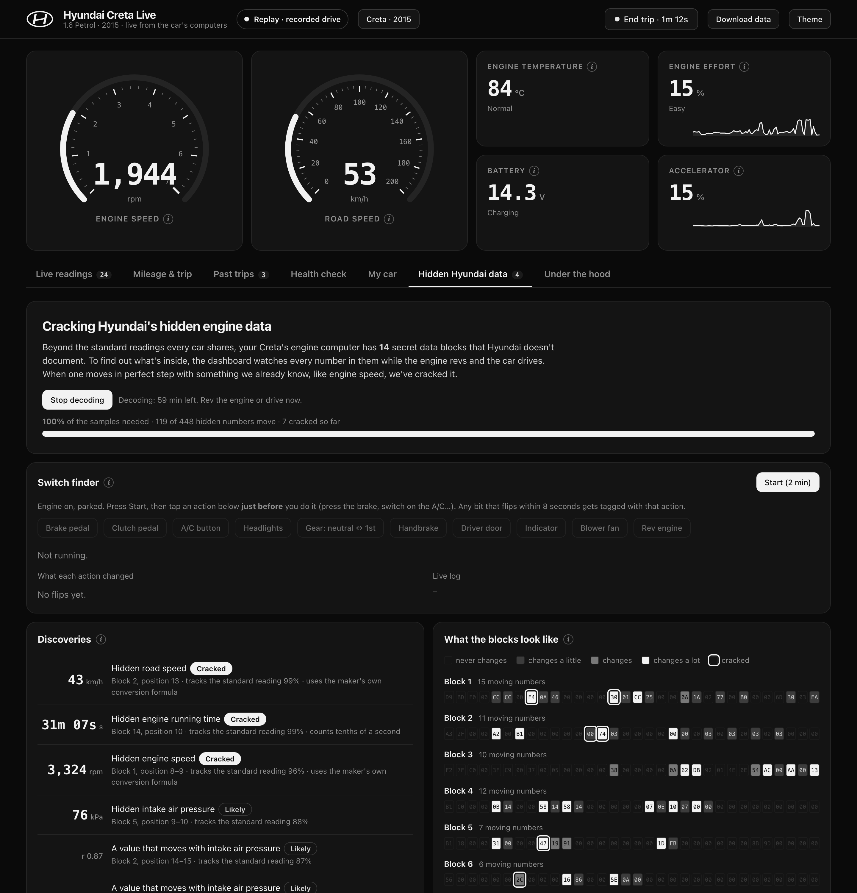
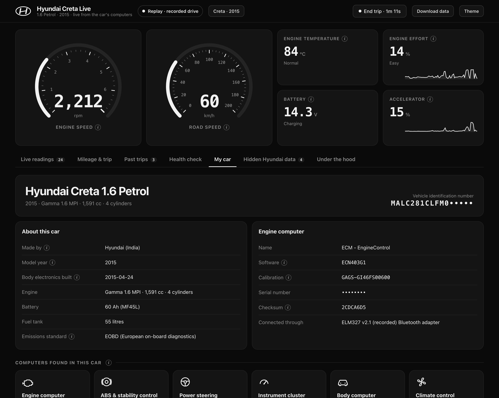
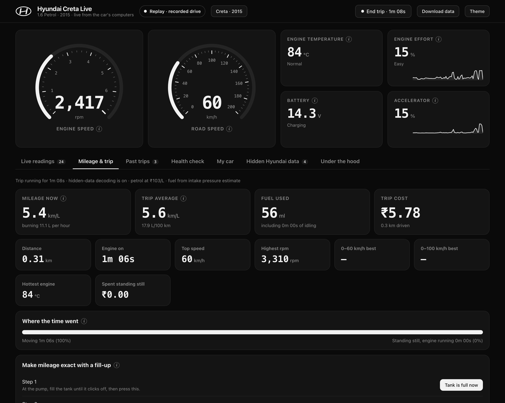
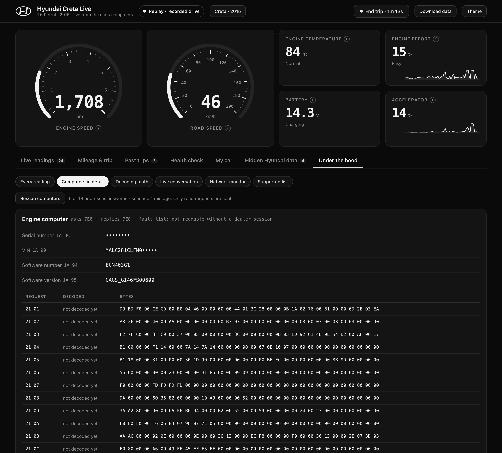
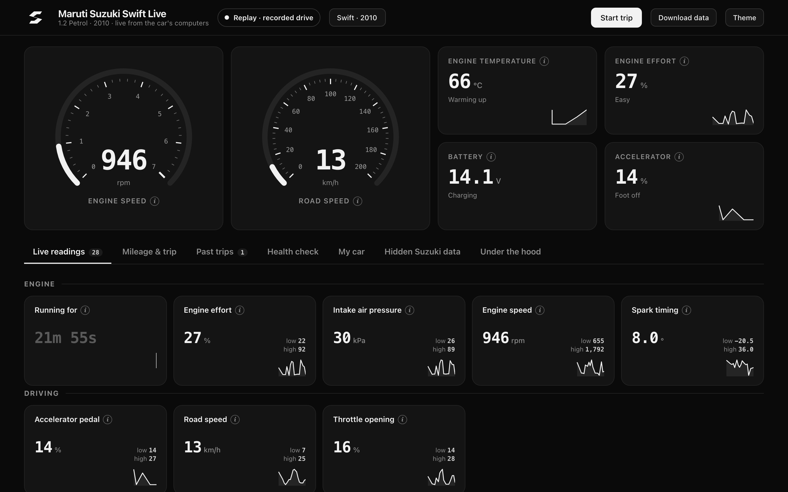
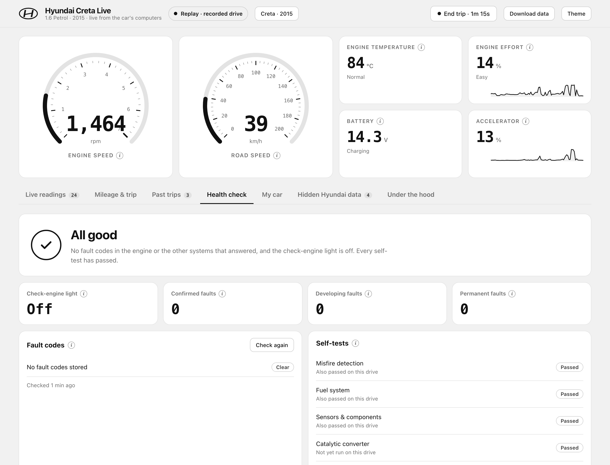
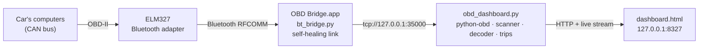

<div align="center">

# CAR OBD Dashboard AI

**Plug a ₹500 ELM327 Bluetooth scanner into your car, and see everything its computers know: live, in plain English, on your Mac.**

Live gauges · health check · per-cylinder misfires · mileage and trip cost · past-trip replays ·
and a reverse-engineering lab that cracks the manufacturer's **hidden** engine data.

**macOS (Apple Silicon)** · **Python 3.11+** · **any ELM327 Bluetooth adapter** · **read-only, never writes to the car**

<picture>
  <source media="(prefers-color-scheme: light)" srcset="docs/screenshots/hero-light.png">
  
</picture>

<sub>A real recorded drive of a 2015 Hyundai Creta, played back with <code>./start.sh --replay</code>.</sub>

</div>

---

## Why this exists

A normal OBD app shows you a handful of numbers. Your car's computers know far more: misfires for
each cylinder, the engine's own self-test results, build dates, and whole blocks of private data the
manufacturer never documents. This project reads all of it, explains it in everyday language, and
decodes the hidden parts by watching how they move while you drive.

It was built and tested on two real cars: a **2015 Hyundai Creta 1.6 petrol** and a **2010 Maruti Suzuki Swift 1.2 (K12M)**.

## What you get

| | |
|---|---|
| **Live readings** | 25–30 sensors per car with sparklines, low/high, and an **ⓘ** on every value explaining what it is and what's normal |
| **Cylinder health** | Misfire count for each cylinder, this trip and the last 10 trips |
| **Health check** | Fault codes (confirmed, developing, permanent), readiness self-tests, the engine's own **lab results** (catalytic converter, O2 sensors, valve timing, heater resistance) |
| **Mileage & trip** | Live km/L, trip average, fuel used, **trip cost in ₹**, money spent idling, 0–60 / 0–100 timers, fill-up calibration |
| **Past trips** | Every trip saved with second-by-second charts (speed, rpm, fuel burn, load, throttle, spark timing), synced crosshair with exact timestamps, highlights |
| **My car** | VIN decode, ECU software and calibration, body-computer build date, every computer that answered on the CAN bus |
| **Hidden data lab** | Correlates the manufacturer's undocumented data blocks against known values to identify fields and their formulas, plus a **switch finder** that shows which bit flips when you press the brake |
| **Under the hood** | Every raw number, full module replies, decoding math, the live conversation with the car, a passive CAN monitor |
| **Two cars, one dashboard** | Car profiles with auto-detection (Hyundai Creta, Suzuki Swift), separate trips and data per car |
| **Self-healing Bluetooth** | A tiny macOS bridge app that survives the macOS Bluetooth serial bug and repairs dropped links in 3–7 seconds |

## Screenshots

| Health check | Past trips |
|---|---|
|  |  |
| **Hidden Hyundai data** | **My car** |
|  |  |
| **Mileage & trip** | **Under the hood** |
|  |  |
| **Second car: Suzuki Swift** | **Light theme** |
|  |  |

## Quick start

Requirements: a Mac (Apple Silicon tested), Python 3.11+, Xcode command line tools
(`xcode-select --install`), and any ELM327 Bluetooth adapter.

```bash
git clone https://github.com/navyansh1/CAR-OBD-Dashboard-AI.git
cd CAR-OBD-Dashboard-AI
./setup.sh
```

**Try it without a car.** This replays real recorded drives:

```bash
./start.sh --replay
```

**Use it with your car:**

1. Plug the adapter into the OBD port (under the dashboard, driver's side) and turn the ignition on.
2. Pair it in **System Settings › Bluetooth** (it usually appears as `OBDII`).
3. Run `./start.sh`. On first run, macOS asks whether **OBD Bridge** may use Bluetooth: click **Allow**.
4. The dashboard opens at <http://127.0.0.1:8327>.

## How it works



### The macOS Bluetooth problem (and the fix)

On Apple Silicon Macs (Sonoma and later), once any program closes a Bluetooth serial port
(`/dev/cu.OBDII`), reopening it *looks* fine but **no data ever flows again** until Bluetooth
restarts or the device is re-paired. Cheap ELM327 adapters hit this constantly.

`OBD Bridge.app` sidesteps it. It talks to the adapter's RFCOMM channel directly through Apple's
IOBluetooth framework, keeps that channel open permanently, and serves it on a local TCP port. If the
adapter goes silent, the bridge drops the Bluetooth link itself and reconnects. It has to be a
(locally built, ad-hoc signed) app because macOS only lets apps that declare Bluetooth use touch
Bluetooth. A bare Python process gets killed.

### Getting more than standard OBD

| Layer | What's read |
|---|---|
| Standard OBD-II | Mode 01 live data (6 values per request on CAN, ~4.5× faster than one at a time), Mode 02 freeze frame, Mode 03/07/0A fault codes, Mode 06 self-test results, Mode 09 VIN / calibration / CVN / ECU name |
| Manufacturer reads | Read-only UDS `22` and KWP `21`/`1A` requests to each computer's own address: identity, build dates, private data blocks |
| Hidden data | Every private data block is re-read during the drive and correlated byte by byte against the standard values read just before and after it. A field that tracks rpm with r ≥ 0.95, using a sensible scale, *is* rpm. |

## What it found on real cars

**2015 Hyundai Creta (Gamma 1.6 MPI)**
- 6 computers answered: engine, ABS, power steering, instrument cluster, body computer, climate control.
- The body computer's build date: 24 April 2015.
- Hidden **road speed** (block `21 02`, byte 12, × 1.25) and **engine speed** (block `21 01`, bytes 7–8, × 0.25), both decoded with Hyundai's own published scalings (r = 0.99 / 0.96).
- Four neighbouring bytes in block `21 07` that each follow spark timing: very likely **spark timing per cylinder**, which standard OBD only gives as one number (r ≈ 0.76–0.85, not yet proven).

**2010 Maruti Suzuki Swift (K12M)**
- A real airflow sensor and a wideband O2 sensor: fuel use is *measured* and the actual air-fuel ratio (λ) is shown. python-obd discards the λ half of PID `01 34`; this decodes it.
- Its private blocks (`21 25`, `21 28`) turned out to be static configuration, with one switch bit found.
- It refuses standard requests on its physical address, so they always go to the broadcast address (otherwise the refusal decodes as "−23 °C").

## Safety: read only

- Never sends Mode 04 (clear codes) or any UDS service that writes, resets, unlocks, controls outputs or runs routines (`10`, `11`, `14`, `27`, `28`, `2E`, `2F`, `31`). The scanner refuses anything except `22`, `21`, `1A`, `19`, `18` and `3E`.
- No data-ID probing on ABS, airbag, steering or radar modules (brute-force scans have been reported to store ESC faults on Kia cars). Those modules only get identity and fault-code reads.
- **Parked mode:** when the car stops answering, the dashboard stops talking to the car entirely and only reads battery voltage from the adapter, so the car's computers can go to sleep. Unplug the adapter if you park for more than a few days: cheap adapters draw power continuously.

## Adding your car

Car profiles live in `cars/*.json`:

```json
{
 "id": "creta", "make": "Hyundai", "short": "Creta", "name": "Hyundai Creta", "variant": "1.6 Petrol",
 "year": 2015, "engine": "Gamma 1.6 MPI · 1,591 cc · 4 cylinders", "fuel_tank": "55 litres",
 "displacement_l": 1.591, "volumetric_efficiency": 0.85, "fuel_price": 103.0, "currency": "₹",
 "logo": "hyundai", "match": {"cal_prefix": "GAGS"}
}
```

`match` lets the dashboard recognise the car by VIN or ECU calibration number and switch profiles
automatically. Manufacturer definitions are in `hyundai_pids.json` and `suzuki_pids.json`; other
makes work fine with standard OBD.

## Project layout

| Path | Purpose |
|---|---|
| `obd_dashboard.py` | Reader, diagnostics, module scan, decoder, trips, switch finder, parked mode, replay, HTTP API |
| `bt_bridge.py`, `bridge/` | Bluetooth bridge and the source of `OBD Bridge.app` (built by `setup.sh`) |
| `hyundai.py` | Read-only manufacturer scanner (Hyundai and Suzuki) |
| `re_learn.py`, `re_offline.py` | Hidden-data correlation decoder |
| `trips.py` | Trip history, highlights, rebuilding trips from logs |
| `cars.py`, `cars/` | Car profiles and auto-detection |
| `dashboard.html` | The whole front end (no build step) |
| `sample_data/` | Recorded drives used by `--replay` (VIN masked, ECU serial removed) |
| `logs/` | Your own data: drive logs, trips, decoding samples (git-ignored) |

## Credits

- [python-OBD](https://github.com/brendan-w/python-OBD) for the OBD-II command set.
- Hyundai Mode 22 definitions from [gdincu/HyundaiElantraCN7_OBD2_PIDs](https://github.com/gdincu/HyundaiElantraCN7_OBD2_PIDs).
- Suzuki Swift definitions from the open [OBDb](https://github.com/OBDb/Suzuki-Swift) database.

## License

[MIT](LICENSE). The bundled manufacturer definitions come from the projects credited above, under their own terms.

<sub>Use at your own risk. Don't look at the dashboard while driving.</sub>
